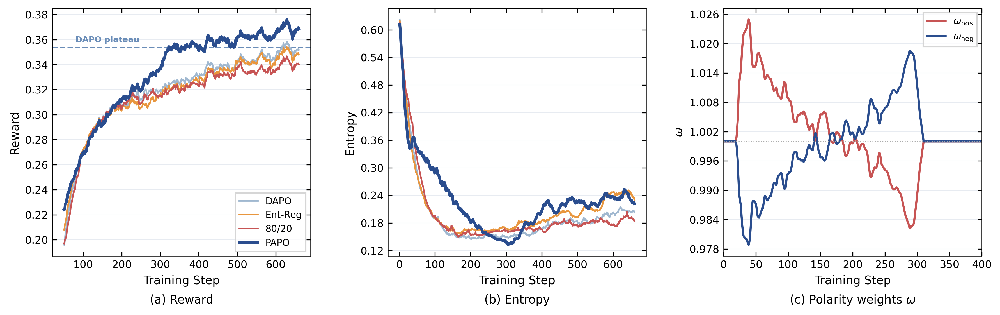

<div align="center">

# PAPO

### Entropy Polarity in Reinforcement Fine-Tuning:<br>Direction, Asymmetry, and Control

**P**olarity-**A**ware **P**olicy **O**ptimization


[](LICENSE)

[Paper](https://arxiv.org/pdf/2605.11775) · [Results](#results) · [Usage](#usage) · [Method](docs/method.md) · [Citation](#citation)

</div>

## Overview

We study **entropy polarity**, a signed token-level quantity that predicts whether
a sampled policy-gradient update locally expands or contracts entropy. Building
on this perspective, **PAPO** retains both polarity branches and adaptively
reweights their advantages using the observed entropy trajectory.

The controller protects exploration during rapid entropy decay and restores
reward-aligned exploitation as the trajectory stabilizes. It operates on existing
advantages, adding no extra forward pass, auxiliary loss, or trainable parameters.



*Qwen2.5-14B math training. PAPO reaches DAPO's mature training reward in approximately
**60% of the training steps**, then continues to improve.*

Our experiments cover mathematical reasoning with Qwen2.5-7B/14B-Base and agentic
tool calling with Qwen2.5-14B-Instruct. This repository contains the math training
recipes and related baselines.

## Results

**Mean@32 (%)** averages the benchmark score over 32 sampled responses per problem.
Bold marks the highest score within each model scale and benchmark. Ent-Reg is
entropy regularization. PAPO achieves the highest score on five of six math
benchmarks at 7B and all six at 14B.

The values below are the results reported in Table 1 of the paper. The four
tables and [`results/mean32.csv`](results/mean32.csv) use the same values;
they are reported experimental results, not scores regenerated by the included
evaluation scripts.

### Qwen2.5-7B-Base

| Method | OlympiadBench | AMC23 | AIME24 | AIME25 | MATH500 | Minerva |
| --- | ---: | ---: | ---: | ---: | ---: | ---: |
| DAPO | 34.68 | 46.09 | 10.83 | 6.04 | 66.19 | 25.14 |
| 80/20 | 34.12 | 47.42 | 9.58 | 5.62 | 65.97 | 24.82 |
| Ent-Reg | 34.65 | 45.86 | 9.79 | **7.71** | 67.05 | 26.88 |
| STEER | 34.47 | 47.11 | 9.17 | 6.04 | 66.23 | 26.14 |
| Clip-Cov | 34.87 | 48.36 | 10.83 | 6.77 | 66.89 | 26.11 |
| KL-Cov | 34.47 | 48.20 | 10.62 | 7.08 | 66.64 | 25.72 |
| **PAPO** | **35.57** | **49.22** | **11.46** | 7.19 | **67.46** | **27.22** |

### Qwen2.5-14B-Base

| Method | OlympiadBench | AMC23 | AIME24 | AIME25 | MATH500 | Minerva |
| --- | ---: | ---: | ---: | ---: | ---: | ---: |
| DAPO | 37.73 | 55.47 | 11.77 | 9.90 | 70.46 | 30.62 |
| 80/20 | 37.47 | 54.53 | 11.98 | 10.83 | 70.37 | 30.41 |
| Ent-Reg | 37.92 | 55.08 | 12.19 | 10.52 | 71.19 | 31.00 |
| STEER | 36.82 | 55.39 | 11.04 | 9.58 | 70.06 | 30.46 |
| Clip-Cov | 37.56 | 55.86 | 11.88 | 10.21 | 70.31 | 29.99 |
| KL-Cov | 37.21 | 55.62 | 11.67 | 8.65 | 70.28 | 30.51 |
| **PAPO** | **39.23** | **58.36** | **13.44** | **12.19** | **71.31** | **31.70** |

The gains on competition math are consistent with the complementary roles of the
two polarity branches: preserving exploratory alternatives while maintaining
optimization pressure to consolidate successful paths.

<details>
<summary><b>Generalization beyond math: CRUX, IFEval, and MMLU-Pro</b></summary>

**Qwen2.5-7B-Base**

| Method | CRUX | IFEval | MMLU-Pro |
| --- | ---: | ---: | ---: |
| DAPO | 41.49 | 30.30 | 44.55 |
| 80/20 | 41.43 | 30.54 | 44.45 |
| Ent-Reg | 41.63 | 30.49 | 44.56 |
| STEER | 41.41 | 30.40 | 44.69 |
| Clip-Cov | 41.46 | 30.56 | 44.58 |
| KL-Cov | 41.39 | **31.01** | 44.60 |
| **PAPO** | **44.79** | 30.65 | **44.76** |

**Qwen2.5-14B-Base**

| Method | CRUX | IFEval | MMLU-Pro |
| --- | ---: | ---: | ---: |
| DAPO | 51.26 | **34.43** | **53.92** |
| 80/20 | 50.36 | 34.23 | 53.80 |
| Ent-Reg | 51.20 | 34.19 | 53.86 |
| STEER | 51.13 | 34.22 | 53.89 |
| Clip-Cov | 49.18 | 34.25 | 53.72 |
| KL-Cov | 49.23 | 34.24 | 53.63 |
| **PAPO** | **51.82** | 34.27 | 53.79 |

At 7B, PAPO improves over DAPO by 3.30 percentage points on CRUX, with comparable
performance on IFEval and MMLU-Pro. At 14B, performance remains comparable across
the three benchmarks.

</details>

See [results and analysis](docs/results.md) for the discussion of benchmark
performance, training dynamics, and branch-conditioned continuations.
All four tables are available as [CSV](results/mean32.csv).

## Usage

The code builds on [verl](https://github.com/volcengine/verl). PAPO is implemented
in [`src/recipe/papo`](src/recipe/papo), with separate modules for
[polarity statistics](src/recipe/papo/dp_actor.py),
[advantage reweighting](src/recipe/papo/control_policy.py), and the
[entropy-slope controller](src/recipe/papo/adaptive_entropy.py).

- **[Using the code](docs/usage.md):** runtime setup, launch-template arguments,
  configuration preview, baseline entry points, and evaluation utilities.
- **[Training configuration](docs/configuration.md):** paper hyperparameters and
  their corresponding configuration keys, including STEER, Clip-Cov, and KL-Cov.
- **[Method](docs/method.md):** entropy polarity, branch assignment, and adaptive
  advantage reweighting.

**Reproduction scope.** The paper's math runs use DAPO-Math-17K, 16 H20 GPUs,
and the settings in the [configuration guide](docs/configuration.md). The
included `data/dapo14k` and `data/polaris53k` files are different datasets;
DAPO-Math-17K is not included here. The PAPO launch script is a general
template whose defaults differ from the paper settings. Supply the paper
dataset and explicitly set the documented overrides before attempting to
reproduce Table 1.

## Acknowledgements

Our code builds on [POLARIS](https://github.com/ChenxinAn-fdu/POLARIS) and
[verl](https://github.com/volcengine/verl), with reward utilities inherited from
[DeepScaleR / rllm](https://github.com/agentica-project/rllm). We thank their authors
and contributors. The [original POLARIS README](docs/references/POLARIS_README.md)
is preserved for reference and attribution.

Our polarity-branch analysis and control build on prior work on token-level
entropy dynamics. Please also refer to and credit the relevant methods:

- **STEER:** Hao et al., [Rethinking Entropy Interventions in RLVR: An Entropy Change Perspective](https://arxiv.org/abs/2510.10150).
- **Clip-Cov / KL-Cov:** Cui et al., [The Entropy Mechanism of Reinforcement Learning for Reasoning Language Models](https://arxiv.org/abs/2505.22617).
- **Entropy dynamics:** Wang et al., [On the Entropy Dynamics in Reinforcement Fine-Tuning of Large Language Models](https://arxiv.org/abs/2602.03392).

## Citation

If you use PAPO, please cite:

```bibtex
@article{zhang2026entropy,
  title={Entropy Polarity in Reinforcement Fine-Tuning: Direction, Asymmetry, and Control},
  author={Zhang, Jiazheng and Fu, Ziche and Shen, Junrui and Zhao, Yunbin and Zhang, Yunke and Xi, Zhiheng and Ma, Long and An, Chenxin and Zhang, Zhihao and Liu, Shichun and others},
  journal={arXiv preprint arXiv:2605.11775},
  year={2026}
}
```

## License

This repository retains the [Apache License 2.0](LICENSE) and upstream copyright
notices. Third-party components and datasets retain their respective licenses.
