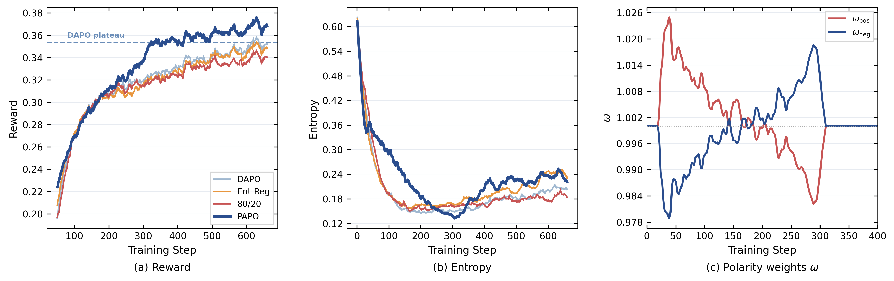

# Results and analysis

[Back to README](../README.md)

We report **Mean@32**: the benchmark score averaged over 32 sampled responses per
problem, expressed as a percentage. **Bold** marks the highest score within each
model scale and benchmark, including ties. Ent-Reg denotes entropy regularization
(“Entropy loss” in the result files).

### Mathematical reasoning

**Qwen2.5-7B-Base**

| Method | OlympiadBench | AMC23 | AIME24 | AIME25 | MATH500 | Minerva |
| --- | ---: | ---: | ---: | ---: | ---: | ---: |
| DAPO | 34.68 | 46.09 | 10.83 | 6.04 | 66.19 | 25.14 |
| 80/20 | 34.12 | 47.42 | 9.58 | 5.62 | 65.97 | 24.82 |
| Ent-Reg | 34.65 | 45.86 | 9.79 | **7.71** | 67.05 | 26.88 |
| STEER | 34.47 | 47.11 | 9.17 | 6.04 | 66.23 | 26.14 |
| Clip-Cov | 34.87 | 48.36 | 10.83 | 6.77 | 66.89 | 26.11 |
| KL-Cov | 34.47 | 48.20 | 10.62 | 7.08 | 66.64 | 25.72 |
| **PAPO** | **35.57** | **49.22** | **11.46** | 7.19 | **67.46** | **27.22** |

**Qwen2.5-14B-Base**

| Method | OlympiadBench | AMC23 | AIME24 | AIME25 | MATH500 | Minerva |
| --- | ---: | ---: | ---: | ---: | ---: | ---: |
| DAPO | 37.73 | 55.47 | 11.77 | 9.90 | 70.46 | 30.62 |
| 80/20 | 37.47 | 54.53 | 11.98 | 10.83 | 70.37 | 30.41 |
| Ent-Reg | 37.92 | 55.08 | 12.19 | 10.52 | 71.19 | 31.00 |
| STEER | 36.82 | 55.39 | 11.04 | 9.58 | 70.06 | 30.46 |
| Clip-Cov | 37.56 | 55.86 | 11.88 | 10.21 | 70.31 | 29.99 |
| KL-Cov | 37.21 | 55.62 | 11.67 | 8.65 | 70.28 | 30.51 |
| **PAPO** | **39.23** | **58.36** | **13.44** | **12.19** | **71.31** | **31.70** |

PAPO achieves the best score on five of six math benchmarks at 7B and all six at
14B. The improvements extend across the two model scales: over DAPO, PAPO gains
3.13 percentage points on AMC23 at 7B, and 1.67 and 2.29 points on AIME24 and AIME25
at 14B. At 14B, its advantage over entropy regularization is more pronounced on
AMC23 and AIME, while performance on MATH500 is comparable. This pattern is
consistent with the complementary branch dynamics: challenging reasoning benefits
from preserving exploratory alternatives while maintaining optimization pressure
to consolidate successful paths.

### Generalization beyond math

**Qwen2.5-7B-Base**

| Method | CRUX | IFEval | MMLU-Pro |
| --- | ---: | ---: | ---: |
| DAPO | 41.49 | 30.30 | 44.55 |
| 80/20 | 41.43 | 30.54 | 44.45 |
| Ent-Reg | 41.63 | 30.49 | 44.56 |
| STEER | 41.41 | 30.40 | 44.69 |
| Clip-Cov | 41.46 | 30.56 | 44.58 |
| KL-Cov | 41.39 | **31.01** | 44.60 |
| **PAPO** | **44.79** | 30.65 | **44.76** |

**Qwen2.5-14B-Base**

| Method | CRUX | IFEval | MMLU-Pro |
| --- | ---: | ---: | ---: |
| DAPO | 51.26 | **34.43** | **53.92** |
| 80/20 | 50.36 | 34.23 | 53.80 |
| Ent-Reg | 51.20 | 34.19 | 53.86 |
| STEER | 51.13 | 34.22 | 53.89 |
| Clip-Cov | 49.18 | 34.25 | 53.72 |
| KL-Cov | 49.23 | 34.24 | 53.63 |
| **PAPO** | **51.82** | 34.27 | 53.79 |

At 7B, PAPO improves over DAPO by 3.30 percentage points on CRUX, with comparable
performance on IFEval and MMLU-Pro. At 14B, performance remains comparable across
the three benchmarks. The CRUX gain, alongside broadly stable instruction-following
and knowledge scores, suggests that polarity-aware training strengthens reasoning
beyond the math domain while retaining broader capabilities.

The four tables are also available as [CSV](../results/mean32.csv).

### Training dynamics

*Qwen2.5-14B math training from the paper. Left: reward; middle: entropy; right:
the positive and negative branch weights.*

PAPO reaches DAPO's mature training reward in approximately **60% of the training
steps**, then continues to improve. Early exploration protection slows entropy
contraction; the subsequent shift toward exploitation consolidates the gains.
The controller therefore uses the entropy trajectory to coordinate learning
phases, rather than maintaining a fixed entropy level.

### What the polarity branches capture

The paper's analysis of continuations after high-polarity events connects polarity
to local reasoning diversity:
positive-polarity prefixes admit more alternatives, while negative-polarity
prefixes are associated with more concentrated continuations.

| Continuation statistic | Positive polarity | Negative polarity |
| --- | ---: | ---: |
| Rare next-token continuations | 290 | 227 |
| Effective two-token branches | 560.8 | 457.7 |
| Two-token repetition probability | 0.00047 | 0.00087 |

Together with the single-branch ablations, this motivates keeping both branches:
preserving alternatives and reinforcing successful trajectories serve
complementary roles in training.
